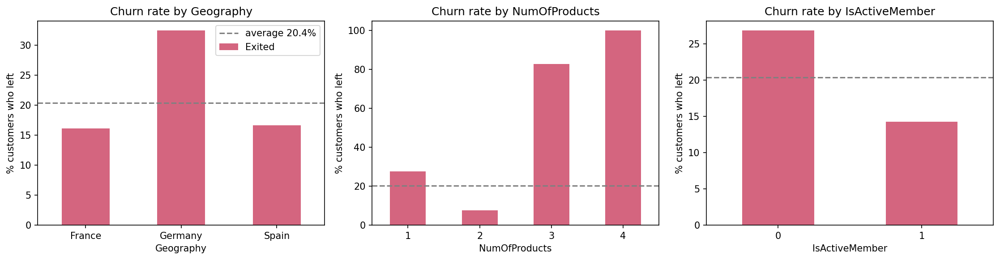
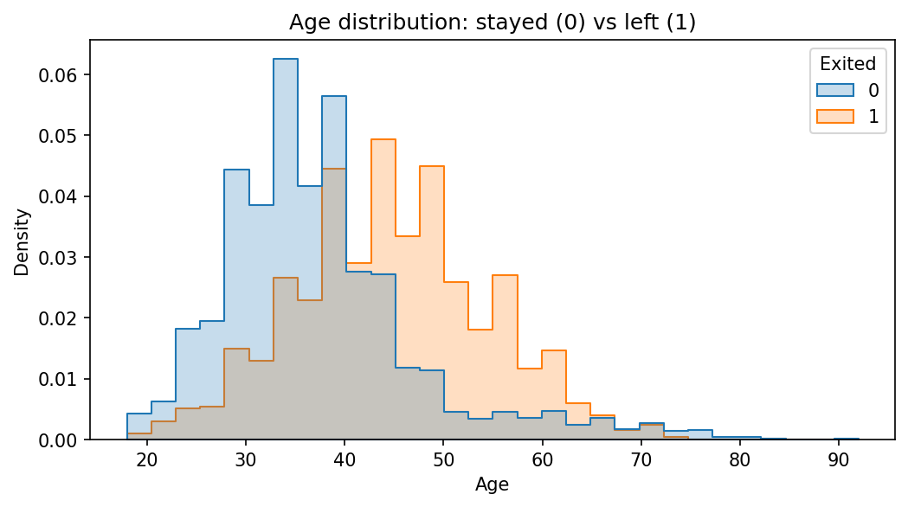
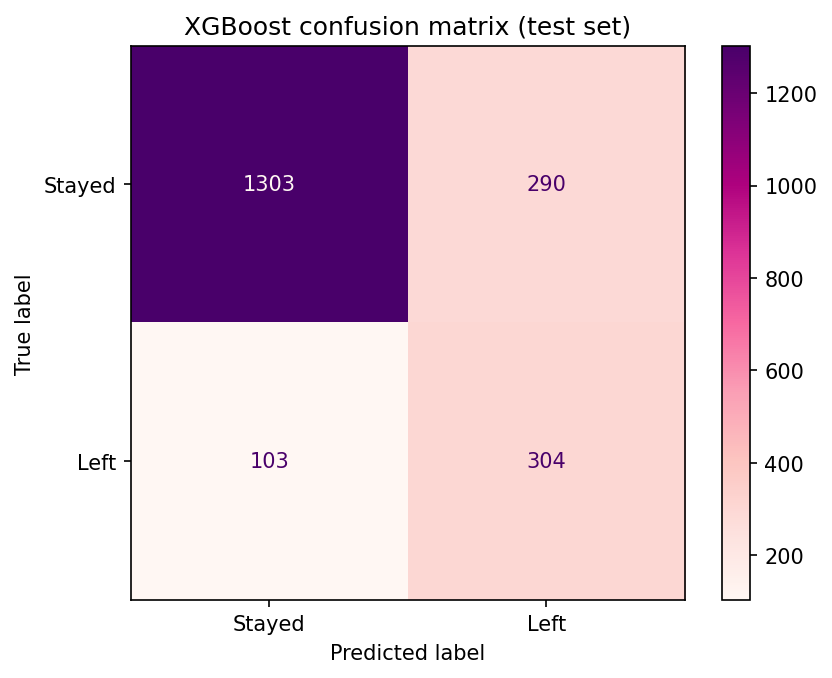
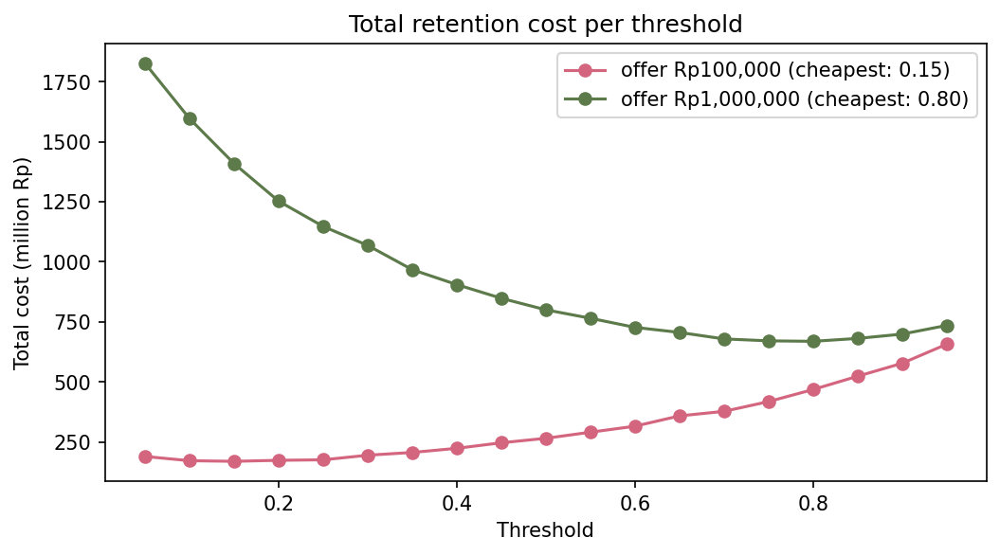
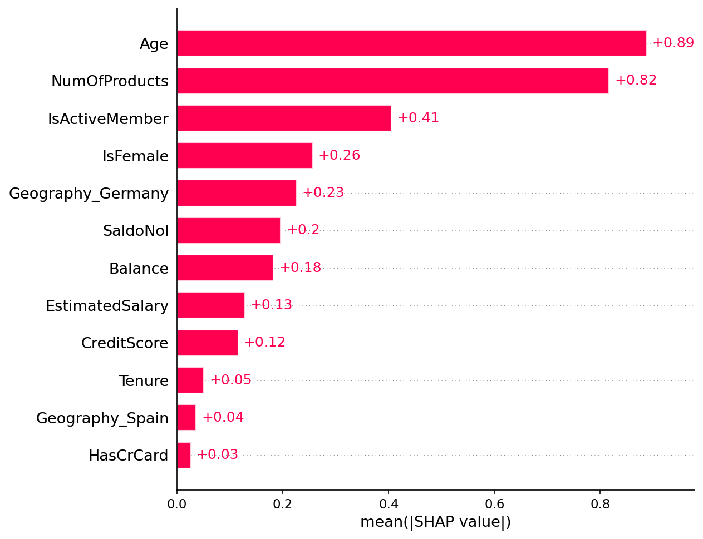
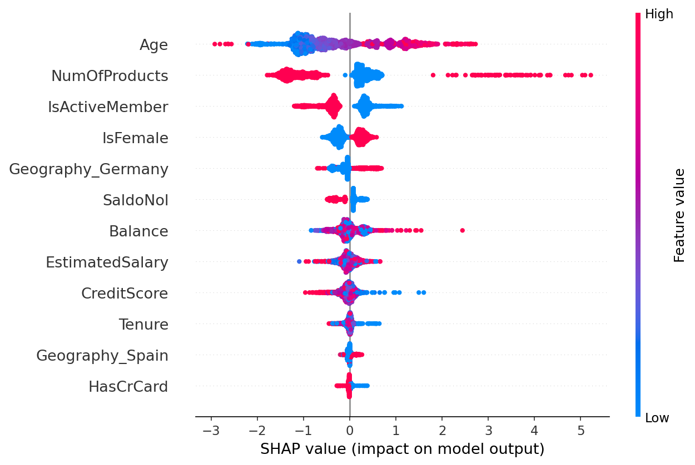

# Bank Customer Churn Prediction

A practical data science project for identifying which bank customers are most likely to leave, why they churn, and how a retention strategy can be prioritized using predictive modeling and explainable AI.

**Notebook:** [bank_churn_analysis.ipynb](bank_churn_analysis.ipynb)

## Overview

This project combines statistical testing, ensemble models, and SHAP to answer three questions on a dataset of 10,000 bank customers:

- Which customers are likely to churn?
- What features are most strongly associated with churn?
- Which actions should the bank take to reduce customer attrition?

## Key results

- **XGBoost reaches ROC-AUC 0.864** on 5-fold cross-validation and captures **75% of customers who leave**, outperforming the logistic regression baseline at 0.766.
- The strongest churn drivers are **age, number of products, inactivity, and gender**, confirmed by both statistical testing and SHAP analysis.
- A confounding check showed that part of the apparent “customers with a balance churn more” effect is driven by Germany, where no customer has a zero balance.
- The recommended decision threshold varies by retention cost: **0.15** for a Rp100k offer and **0.80** for a Rp1m offer.

## Dataset

[Churn Modelling](https://www.kaggle.com/datasets/shrutimechlearn/churn-modelling) from Kaggle contains 10,000 customers from France, Germany, and Spain. The target variable is `Exited`, where `1` indicates the customer left the bank. The churn rate is **20.4%**, so the dataset is moderately imbalanced.

## Approach

1. **Data cleaning:** removed identifier columns (`RowNumber`, `CustomerId`, `Surname`); no missing values or duplicates were found.
2. **Exploratory analysis:** evaluated churn rates by customer segment instead of raw counts.
3. **Statistical testing:** used chi-square tests for categorical variables and Mann-Whitney U tests for numeric variables, along with a confounding check by country.
4. **Modeling:** compared Logistic Regression, Random Forest, and XGBoost with class weighting for imbalance, then evaluated precision, recall, F1 score, and ROC-AUC.
5. **Threshold selection:** optimized retention contact thresholds based on cost assumptions.
6. **Explainability:** used SHAP values to interpret the model’s predictions.

## Findings

| Group | Churn rate |
|---|---|
| Germany | 32.4% (France 16.2%, Spain 16.7%) |
| Inactive members | 26.9% (active 14.3%) |
| 1 product / 2 products / 3–4 products | 27.7% / 7.6% / 83–100% |
| Female | 25.1% (male 16.5%) |
| Has a credit card or not | 20.2% vs 20.8%, no significant difference |

Customers aged 45–60 churn most often, while customers above 70 are among the most loyal.

**Not significant:** credit card ownership, estimated salary, and tenure (p > 0.05).

## Model performance

| Model | Precision | Recall | F1 | ROC-AUC (test) | ROC-AUC (5-fold CV) |
|---|---:|---:|---:|---:|---:|
| Logistic Regression | 0.389 | 0.705 | 0.501 | 0.777 | 0.766 ± 0.021 |
| Random Forest | 0.629 | 0.641 | 0.635 | 0.863 | 0.860 ± 0.011 |
| XGBoost | 0.512 | 0.747 | 0.607 | 0.867 | 0.864 ± 0.013 |

Random Forest and XGBoost are statistically tied. Both clearly outperform the linear baseline because churn is not linear in age or product count.

## Choosing a threshold

The model outputs a churn risk score, and the decision threshold determines which customers are contacted by the retention team. Assuming a lost customer costs the bank Rp2 million:

| Retention offer cost | Cheapest threshold |
|---|---|
| Rp100,000 | 0.15 (contact broadly, miss almost no one) |
| Rp1,000,000 | 0.80 (contact only the highest-risk customers) |

## What drives churn (SHAP)

## Recommendations

| Finding | Recommendation |
|---|---|
| Customers with 3–4 products churn 83–100% | Review product bundling |
| Inactive members churn almost twice as often | Launch re-activation campaigns with reminders and first-transaction cashback |
| Ages 45–60 are the highest-risk group | Offer pre-retirement products, such as investment and pension support |
| German customers churn 32% | Investigate the German market: competitors, service quality, and fees |
| Customers with a balance churn more | Offer tailored benefits and rate-based incentives to high-balance clients |
| The model catches 75% of leavers | Use risk scores to prioritize the retention call list |

## Limitations

- The 4-product group contains only 60 customers, so its 100% churn rate needs further validation.
- Retention costs are assumptions rather than real bank figures.
- The model still includes `EstimatedSalary`, which was not significant in the statistical tests.
- The data comes from three European countries; results may not transfer directly to other banking environments.

## Tools

Python, pandas, SciPy, scikit-learn, XGBoost, SHAP, matplotlib, seaborn, Google Colab

## Project source

- GitHub: [vishu2726/bank-churn-prediction](https://github.com/vishu2726/bank-churn-prediction.git)
- Author/source: vishu2726

